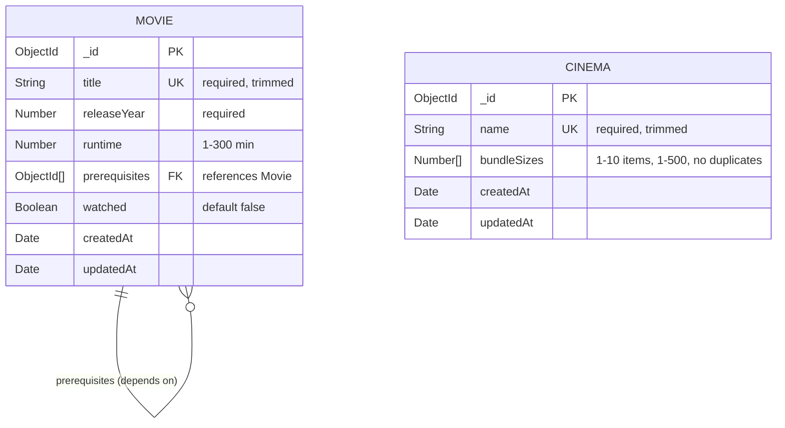

# Doomsday Ready 🛡️🎬

**Doomsday Ready** is a full-stack MERN application (Node.js, Express with ES modules, MongoDB / Mongoose, and React + Vite) designed to help Marvel fans prepare for *Avengers: Doomsday*.

The app provides two core features:
1. **Interactive Rewatch Planner**: Computes the optimal post-order sequence to binge prerequisite movies before a target film, with real-time watched status tracking and cycle detection.
2. **Cinema Group Booking Optimizer**: Calculates the minimum ticket bundle combination needed to seat any group size at participating cinemas using dynamic programming.

---

## Architecture & Tech Stack

- **Backend**: Node.js (v20+), Express (ES Modules), Mongoose 8
- **Frontend**: React 19, React Router 7, Vite, Vanilla CSS
- **Database**: MongoDB 7.0 (with Docker volume persistence)
- **Containerization & Reverse Proxy**: Docker, Docker Compose, Nginx

---

## One-Command Docker Start

Run the entire stack (MongoDB, Backend Server, and Nginx-served Frontend) with a single command:

```bash
docker compose up --build
```

### Accessing the Services
- **Web Application (Frontend)**: [http://localhost](http://localhost) (Port 80)
- **Backend API**: [http://localhost:5000/api](http://localhost:5000/api)
- **API Health Check**: [http://localhost:5000/api/health](http://localhost:5000/api/health)
- **MongoDB**: `localhost:27017`

### Seed the Database in Docker
To populate the database with the 8 sample MCU movies and 4 cinema venues:

```bash
docker compose exec server npm run seed
```

### Stop the Containers
```bash
docker compose down
```

---

## Local Setup (Without Docker)

### Prerequisites
- Node.js (v18 or higher)
- npm (v9 or higher)
- Running MongoDB instance (Local or MongoDB Atlas connection string)

### 1. Backend Server Setup
```bash
cd server
npm install

# Configure environment variables
cp .env.example .env
# Edit .env and verify PORT and MONGO_URI:
# PORT=5000
# MONGO_URI=mongodb://localhost:27017/doomsday-ready

# Seed the database with sample movies and cinemas
npm run seed

# Run automated service test suite
npm test

# Start backend server in development mode
npm run dev
```
Backend will be live at `http://localhost:5000`.

### 2. Frontend Client Setup
```bash
cd client
npm install

# Start Vite development server
npm run dev
```
Client will be live at `http://localhost:5173`.

---

## Database Schema (ER Diagram)

The schema represents movies with self-referential prerequisite relationships (DAG) and cinemas with validated bundle sizes:



---

## API Reference

All error responses strictly follow the uniform shape:
```json
{
  "error": {
    "code": "ERROR_CODE",
    "message": "Human readable error description"
  }
}
```

### Movies Endpoints (`/api/movies`)

| Method | Endpoint | Description | Request Body / Query | Success | Errors |
| :--- | :--- | :--- | :--- | :--- | :--- |
| `POST` | `/api/movies` | Create a movie | `{ title, releaseYear, runtime, prerequisites?, watched? }` | `201 Created` | `400 VALIDATION_ERROR`<br>`400 INVALID_PREREQUISITES`<br>`409 DUPLICATE`<br>`409 CIRCULAR_DEPENDENCY` |
| `GET` | `/api/movies` | List all movies | None | `200 OK` | `500 INTERNAL_ERROR` |
| `PATCH` | `/api/movies/:id` | Update allowed fields | `{ title?, releaseYear?, runtime?, prerequisites?, watched? }` | `200 OK` | `400 INVALID_ID`<br>`400 INVALID_PREREQUISITES`<br>`404 NOT_FOUND`<br>`409 CIRCULAR_DEPENDENCY` |
| `GET` | `/api/movies/:id/rewatch-order` | Calculate post-order sequence | None | `200 OK` | `400 INVALID_ID`<br>`404 NOT_FOUND` |

### Cinemas Endpoints (`/api/cinemas`)

| Method | Endpoint | Description | Request Body / Query | Success | Errors |
| :--- | :--- | :--- | :--- | :--- | :--- |
| `POST` | `/api/cinemas` | Create cinema venue | `{ name, bundleSizes }` | `201 Created` | `400 VALIDATION_ERROR`<br>`409 DUPLICATE` |
| `GET` | `/api/cinemas` | List all cinemas | None | `200 OK` | `500 INTERNAL_ERROR` |
| `GET` | `/api/cinemas/:id/booking` | Calculate optimal booking quote | `?groupSize=<1-10000>` | `200 OK` | `400 INVALID_ID`<br>`400 INVALID_GROUP_SIZE`<br>`404 NOT_FOUND` |

---

## Core Algorithms

### 1. Rewatch Order: DFS Topological Sort & Cycle Detection (`services/rewatchOrder.js`)
- **Cycle Detection**:
  - Before creating or updating prerequisites, a graph map `id -> [prerequisiteIds]` is constructed.
  - Depth-First Search (DFS) traverses candidate prerequisites with a `visited` set.
  - If the search ever traverses back to the movie's own ID, a direct or indirect cycle exists and an `AppError(409, 'CIRCULAR_DEPENDENCY')` is raised.
- **Topological Post-Order**:
  - Given a target movie ID, DFS post-order traversal visits all prerequisite nodes recursively.
  - A `visited` set ensures diamond dependencies (e.g., multiple movies sharing a common predecessor like *Iron Man*) are visited exactly once.
  - The node is added to the output list only after all its prerequisites have been processed, ensuring that every movie appears strictly after its required predecessors.
  - The target movie itself is excluded from the returned order.
  - Computes `watchedCount`, `totalCount`, and `remainingRuntime` (summing runtime of unwatched prerequisites).

### 2. Group Booking: Dynamic Programming Coin-Change (`services/bookingQuote.js`)
- **Optimal Substructure**:
  - The problem is modeled as the classic minimum coin change problem where bundle sizes represent coin denominations and `groupSize` represents the target value.
  - State array: `dp[i]` stores the minimum number of bundles needed to form group size `i`.
  - Base case: `dp[0] = 0`; all other values initialized to `Infinity`.
  - Recurrence relation:
    $$\text{dp}[i] = \min(\text{dp}[i], \text{dp}[i - \text{size}] + 1) \quad \forall \text{ size} \le i$$
- **Backtracking & Reconstitution**:
  - An auxiliary `choice[i]` array records the exact bundle size chosen to achieve the optimal `dp[i]`.
  - Backtracks from `groupSize` down to `0` by repeatedly subtracting `choice[current]`, collecting quantities in a Map.
  - Returns bundles sorted in descending order of size: `{ possible: true, totalBundles, bundles: [{ size, count }] }`.
  - If `dp[groupSize] === Infinity`, returns `{ possible: false, message }`.

---

## AI Usage

I used AI tools for scaffolding and reviewing; the core logic of features 1 and 2 I wrote and understood myself.

- **AI Assistance**: Generating baseline project boilerplate, configuring multi-stage Dockerfiles and Nginx reverse proxy directives, structuring repetitive test fixtures, and reviewing edge case coverage.
- **Independent Core Implementation**: The graph cycle-detection DFS, topological post-order traversal, and the dynamic programming minimum-coin-change algorithm with backtracking were directly designed, implemented, and verified to ensure full algorithmic correctness and zero external library dependency.

---

## Assumptions

1. **Prerequisite Graph is a DAG**: Movie dependencies must form a Directed Acyclic Graph. Self-dependencies and indirect circular loops are strictly forbidden and rejected with HTTP 409. Duplicate prerequisite IDs are automatically deduplicated before saving.
2. **Case-Insensitive Title Uniqueness**: Movie titles are uniquely enforced in a case-insensitive manner (e.g. "Iron Man" and "iron man" conflict and return 409 `DUPLICATE`) to prevent confusing duplicate entries across searches and rewatch plans.
3. **Cinema Bundle Sizes Uniqueness**: Cinema `bundleSizes` strictly reject duplicates (e.g. `[2, 2, 5]` returns 400 `VALIDATION_ERROR`) to prevent silent masking of client input typos.
4. **Target Movie Exclusion**: The target movie represents the end goal and is not included in the rewatch checklist or the remaining watch time calculation.
5. **Exact Seat Coverage**: Ticket bundles cannot be partially split or overbought; the group size must be covered exactly by the available bundle sizes. If no exact combination exists, `{ possible: false }` is returned.
6. **Group Size Constraints**: Booking group sizes are constrained to positive integers between 1 and 10,000 to reflect realistic theater capacities and maintain bounded $O(N \cdot M)$ dynamic programming performance.
7. **Prerequisite Integrity**: Prerequisite movie IDs must correspond to existing database records; referencing deleted or nonexistent IDs yields a 400 validation error. Invalid ObjectId formats return 400 `INVALID_ID`, and unknown IDs return 404 `NOT_FOUND`.
