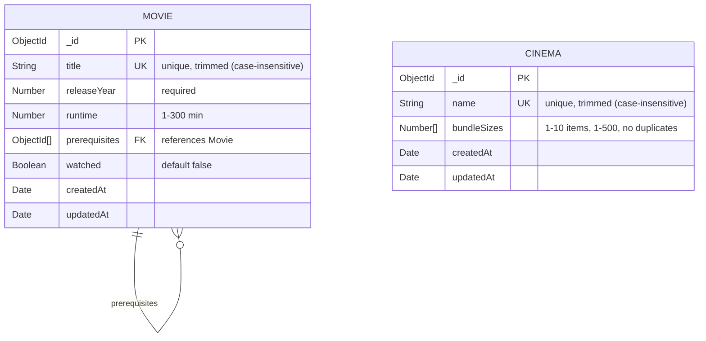

# Doomsday Ready 🛡️🎬

> A full-stack MERN application to plan an MCU rewatch before *Avengers: Doomsday* and optimize group ticket bookings across cinema chains.

[](#)  
🔗 **Live Demo:** [https://doomsday-ready.demo.com](https://doomsday-ready.demo.com) *(Demo link placeholder)*

---

## Table of Contents
- [Overview](#overview)
- [Features](#features)
- [Tech Stack](#tech-stack)
- [Quick Start](#quick-start)
  - [Docker (Recommended)](#docker-recommended)
  - [Local Setup (Without Docker)](#local-setup-without-docker)
- [Project Structure](#project-structure)
- [API Reference & Examples](#api-reference--examples)
- [Database Schema](#database-schema)
- [How the Algorithms Work](#how-the-algorithms-work)
- [AI Usage](#ai-usage)
- [Assumptions](#assumptions)
- [Screenshots](#screenshots)

---

## Overview

Ahead of *Avengers: Doomsday*, watching all essential Marvel movies in the right order can be daunting due to non-linear narrative prerequisites. Furthermore, booking cinema seats for watch parties with fixed bundle sizes often results in wasted tickets.

**Doomsday Ready** solves both problems:
1. It models movie prerequisites as a **Directed Acyclic Graph (DAG)**, calculates the exact topological rewatch sequence using **post-order Depth-First Search**, and prevents circular dependencies.
2. It solves cinema ticket bundle optimization using a **Dynamic Programming Minimum-Coin-Change algorithm** to guarantee the minimum number of ticket packages needed for any group size.

---

## Features

### 1. Movie Management & Rewatch Order (Feature 1)
- **Add & Manage Movies**: Set title, release year, runtime (1–300 min), watched status, and prerequisite links.
- **Topological Rewatch Sequence**: Generates a flattened binge-watch list where every prerequisite appears strictly before the films that depend on it.
- **Cycle Prevention**: Validates both direct self-dependencies and multi-hop indirect circular loops (returning `409 CIRCULAR_DEPENDENCY`).
- **Watched & Runtime Tracking**: Tracks watched movies and calculates total remaining unwatched watch time (e.g. `2h 15m`).

### 2. Cinema Venues & Booking Quotes (Feature 2)
- **Cinema Venues**: Stores cinema chains and their available ticket bundles (e.g. bundles of 1, 3, 4 seats or 2, 5 seats).
- **Optimal Bundle Solver**: Computes the exact minimum bundle count for group sizes from 1 to 10,000 using dynamic programming.
- **Feasibility Detection**: Returns clean `{ possible: false, message }` if the target group size cannot be fulfilled with available packages.

### 3. Modern React Single-Page Application
- **Movies View (`/`)**: Form to add new movies, grid of collection cards, one-click watched status toggle, and an edit prerequisites modal.
- **Rewatch Plan View (`/rewatch`)**: Target movie selector, visual progress bar, remaining watch time counter, and an interactive checklist.
- **Cinema Booking View (`/booking`)**: Cinema venue selector, group size input, visual bundle breakdown, and receipt cards.

---

## Tech Stack

| Layer | Technologies |
| :--- | :--- |
| **Backend** | Node.js (ES Modules), Express.js, Mongoose 8 |
| **Frontend** | React 19, React Router 7, Vite, Vanilla CSS |
| **Database** | MongoDB 7.0 |
| **Testing** | Node.js native test runner (`node:test`, `node:assert`) |
| **DevOps** | Docker, Docker Compose, Nginx (Alpine) |
| **Code Quality** | ESLint 10 (Flat config), Prettier |

---

## Quick Start

### Docker (Recommended)

Run the entire application (MongoDB, Express server, and Nginx-hosted client) with a single command:

```bash
docker compose up --build
```

- **Frontend**: [http://localhost](http://localhost) (Port 80)
- **Backend API**: [http://localhost:5000/api](http://localhost:5000/api)
- **API Health Check**: [http://localhost:5000/api/health](http://localhost:5000/api/health)

To seed sample MCU movies and cinema chains inside Docker:
```bash
docker compose exec server npm run seed
```

To stop the containers:
```bash
docker compose down
```

---

### Local Setup (Without Docker)

#### Prerequisites
- Node.js (v18 or higher)
- Running MongoDB instance (Local on `mongodb://localhost:27017` or MongoDB Atlas URI)

#### 1. Backend Server
```bash
cd server
npm install

# Configure environment variables
cp .env.example .env
# Ensure PORT=5000 and MONGO_URI are set in .env

# Populate the database with 8 MCU movies and 4 cinema venues
npm run seed

# Run automated tests (17 native unit tests)
npm test

# Start backend server in development mode
npm run dev
```

#### 2. Frontend Client
```bash
cd client
npm install

# Start Vite development server
npm run dev
```
Open [http://localhost:5173](http://localhost:5173) in your browser.

---

## Project Structure

```
doomsday-ready/
├── client/                          # React + Vite frontend SPA
│   ├── public/                      # Static assets & favicon
│   ├── src/
│   │   ├── components/              # Reusable UI components
│   │   │   ├── ErrorMessage.jsx     # Dismissible error banner
│   │   │   ├── Navbar.jsx           # Top navigation bar
│   │   │   └── ProgressBar.jsx      # Watched progress indicator
│   │   ├── pages/                   # Application views
│   │   │   ├── BookingPage.jsx      # Cinema booking quote view
│   │   │   ├── MoviesPage.jsx       # Movie list & creation view
│   │   │   └── RewatchPlanPage.jsx  # Topological rewatch planner view
│   │   ├── api.js                   # Centralized API fetch client
│   │   ├── App.css                  # Responsive dark-theme styling
│   │   ├── App.jsx                  # React Router configuration
│   │   ├── index.css                # Global CSS variables & reset
│   │   └── main.jsx                 # Client entry point
│   ├── .dockerignore
│   ├── .env                         # VITE_API_URL configuration
│   ├── .prettierrc
│   ├── Dockerfile                   # Multi-stage Vite + Nginx build
│   ├── eslint.config.js
│   ├── index.html
│   ├── nginx.conf                   # Nginx config with /api reverse proxy
│   └── vite.config.js
├── server/                          # Express.js REST API
│   ├── src/
│   │   ├── config/
│   │   │   ├── constants.js         # Centralized domain bounds & limits
│   │   │   └── db.js                # MongoDB connection helper
│   │   ├── controllers/             # Slim HTTP request/response handlers
│   │   │   ├── cinemaController.js
│   │   │   └── movieController.js
│   │   ├── middleware/              # Global error handling
│   │   │   └── errorHandler.js
│   │   ├── models/                  # Mongoose data models
│   │   │   ├── Cinema.js
│   │   │   └── Movie.js
│   │   ├── routes/                  # Express route definitions
│   │   │   ├── cinemas.js
│   │   │   └── movies.js
│   │   ├── services/                # Business logic & pure algorithms
│   │   │   ├── bookingQuote.js      # Pure DP minimum-bundle calculator
│   │   │   ├── cinemaService.js     # Cinema CRUD & quote delegation
│   │   │   ├── movieService.js      # Movie CRUD & uniqueness validation
│   │   │   └── rewatchOrder.js      # Pure DFS topological sort & cycle check
│   │   ├── utils/
│   │   │   ├── AppError.js          # Custom error class (status + code)
│   │   │   └── asyncHandler.js      # Express async route wrapper
│   │   ├── app.js                   # Express app setup & route mounting
│   │   ├── seed.js                  # Database seed script
│   │   └── server.js                # Server entry point
│   ├── tests/                       # Unit tests (node:test)
│   │   ├── bookingQuote.test.js
│   │   └── rewatchOrder.test.js
│   ├── .dockerignore
│   ├── .env.example
│   ├── .prettierrc
│   ├── Dockerfile                   # Node 20 Alpine production image
│   ├── eslint.config.js
│   ├── package.json
│   └── requests.http                # VS Code / JetBrains HTTP test collection
├── .gitignore
├── docker-compose.yml               # Multi-container service definitions
└── README.md
```

---

## API Reference & Examples

All error responses strictly follow the uniform structure:
```json
{
  "error": {
    "code": "ERROR_CODE",
    "message": "Human-readable description"
  }
}
```

### Endpoints Overview

| Method | Endpoint | Description | Status Codes |
| :--- | :--- | :--- | :--- |
| `GET` | `/api/health` | Service health status | `200` |
| `GET` | `/api/movies` | List all movies | `200` |
| `POST` | `/api/movies` | Create a new movie | `201`, `400`, `409` |
| `PATCH` | `/api/movies/:id` | Update allowed movie fields | `200`, `400`, `404`, `409` |
| `GET` | `/api/movies/:id/rewatch-order` | Compute topological rewatch sequence | `200`, `400`, `404` |
| `GET` | `/api/cinemas` | List all cinema venues | `200` |
| `POST` | `/api/cinemas` | Create a new cinema venue | `201`, `400`, `409` |
| `GET` | `/api/cinemas/:id/booking` | Calculate optimal ticket bundles | `200`, `400`, `404` |

---

### Request & Response Examples

#### 1. Create Movie (`POST /api/movies`)
```http
POST /api/movies
Content-Type: application/json

{
  "title": "Black Panther",
  "releaseYear": 2018,
  "runtime": 134,
  "prerequisites": ["6b0065603e461bb282492dce"]
}
```
**Response (`201 Created`):**
```json
{
  "_id": "6b0065603e461bb282492de1",
  "title": "Black Panther",
  "releaseYear": 2018,
  "runtime": 134,
  "prerequisites": ["6b0065603e461bb282492dce"],
  "watched": false,
  "createdAt": "2026-11-20T20:00:00.000Z",
  "updatedAt": "2026-11-20T20:00:00.000Z"
}
```

#### 2. List Movies (`GET /api/movies`)
**Response (`200 OK`):**
```json
[
  {
    "_id": "6b0065603e461bb282492dc6",
    "title": "Iron Man",
    "releaseYear": 2008,
    "runtime": 126,
    "prerequisites": [],
    "watched": true
  }
]
```

#### 3. Update Movie (`PATCH /api/movies/:id`)
```http
PATCH /api/movies/6b0065603e461bb282492dc6
Content-Type: application/json

{
  "watched": true,
  "runtime": 126
}
```
**Response (`200 OK`):**
```json
{
  "_id": "6b0065603e461bb282492dc6",
  "title": "Iron Man",
  "releaseYear": 2008,
  "runtime": 126,
  "prerequisites": [],
  "watched": true
}
```

#### 4. Rewatch Order (`GET /api/movies/:id/rewatch-order`)
```http
GET /api/movies/6b0065603e461bb282492dd4/rewatch-order
```
**Response (`200 OK`):**
```json
{
  "target": {
    "_id": "6b0065603e461bb282492dd4",
    "title": "Avengers: Doomsday",
    "releaseYear": 2026,
    "runtime": 180
  },
  "order": [
    { "_id": "6b0065603e461bb282492dc6", "title": "Iron Man", "runtime": 126, "watched": true },
    { "_id": "6b0065603e461bb282492dc8", "title": "Captain America: The First Avenger", "runtime": 124, "watched": false },
    { "_id": "6b0065603e461bb282492dcc", "title": "The Avengers", "runtime": 143, "watched": false },
    { "_id": "6b0065603e461bb282492dce", "title": "Captain America: Civil War", "runtime": 147, "watched": false },
    { "_id": "6b0065603e461bb282492dca", "title": "Thor: Ragnarok", "runtime": 130, "watched": false },
    { "_id": "6b0065603e461bb282492dd0", "title": "Avengers: Infinity War", "runtime": 149, "watched": false },
    { "_id": "6b0065603e461bb282492dd2", "title": "Avengers: Endgame", "runtime": 181, "watched": false }
  ],
  "watchedCount": 1,
  "totalCount": 7,
  "remainingRuntime": 874
}
```

#### 5. Circular Dependency Error (`409 CIRCULAR_DEPENDENCY`)
Attempting to make *Avengers: Endgame* a prerequisite of *Iron Man*:
```http
PATCH /api/movies/6b0065603e461bb282492dc6
Content-Type: application/json

{
  "prerequisites": ["6b0065603e461bb282492dd2"]
}
```
**Response (`409 Conflict`):**
```json
{
  "error": {
    "code": "CIRCULAR_DEPENDENCY",
    "message": "Movie cannot depend on itself directly or indirectly"
  }
}
```

#### 6. Create Cinema (`POST /api/cinemas`)
```http
POST /api/cinemas
Content-Type: application/json

{
  "name": "Nova Starplex",
  "bundleSizes": [5, 10, 25]
}
```
**Response (`201 Created`):**
```json
{
  "_id": "6b0065603e461bb282492df0",
  "name": "Nova Starplex",
  "bundleSizes": [5, 10, 25],
  "createdAt": "2026-11-20T20:00:00.000Z",
  "updatedAt": "2026-11-20T20:00:00.000Z"
}
```

#### 7. List Cinemas (`GET /api/cinemas`)
**Response (`200 OK`):**
```json
[
  {
    "_id": "6b0065603e461bb282492dd6",
    "name": "Stark Starkplex",
    "bundleSizes": [1, 3, 4]
  }
]
```

#### 8. Booking Quote: Feasible (`GET /api/cinemas/:id/booking?groupSize=6`)
At Stark Starkplex (bundle sizes `[1, 3, 4]`):
```http
GET /api/cinemas/6b0065603e461bb282492dd6/booking?groupSize=6
```
**Response (`200 OK`):**
```json
{
  "possible": true,
  "totalBundles": 2,
  "bundles": [
    {
      "size": 3,
      "count": 2
    }
  ]
}
```

#### 9. Booking Quote: Not Possible (`GET /api/cinemas/:id/booking?groupSize=7`)
At Sanctum Sanctorum Cine (bundle sizes `[4, 6]`):
```http
GET /api/cinemas/6b0065603e461bb282492dd9/booking?groupSize=7
```
**Response (`200 OK`):**
```json
{
  "possible": false,
  "message": "Cannot form group size of 7 with available bundle sizes"
}
```

---

## Database Schema



---

## How the Algorithms Work

### 1. DFS Cycle Detection (`detectCycle`)
- **Concept**: Before storing prerequisite links on `POST` or `PATCH`, the algorithm verifies that adding the new links does not create a closed loop.
- **Logic**:
  - Direct self-dependencies (`movieId` in its own prerequisites) are rejected immediately.
  - For candidate prerequisites, a recursive Depth-First Search traverses existing dependencies.
  - A `visited` set records inspected nodes to avoid redundant re-traversals.
  - If the search ever traverses to the target movie's ID, a cycle exists $\rightarrow$ `409 CIRCULAR_DEPENDENCY`.
- **Complexity**:
  - **Time**: $O(V + E)$ where $V$ is the number of movies and $E$ is the number of prerequisite edges.
  - **Space**: $O(V)$ for the recursion stack and visited set.

### 2. Topological Rewatch Order (`getRewatchOrder`)
- **Concept**: Computes the exact post-order dependency sequence so that a viewer always watches prerequisite films before dependent films.
- **Logic**:
  - Starting from `targetMovieId`, DFS recursively visits every prerequisite node before appending the current movie to the `order` array.
  - A global `visited` set ensures diamond dependencies (e.g. $D \rightarrow B, C$ where both $B, C \rightarrow A$) only process $A$ once.
  - The target movie itself is excluded from the returned order.
  - Computes `watchedCount` and `remainingRuntime` (summing runtime of unwatched prerequisites).
- **Complexity**:
  - **Time**: $O(V + E)$ visits each node and dependency edge once.
  - **Space**: $O(V)$ for the visited set and result order.

### 3. Dynamic Programming Minimum Bundles (`calculateBookingQuote`)
- **Concept**: Formulated as the classic Minimum Coin Change problem where bundle sizes act as coin denominations and `groupSize` is the target value.
- **Logic**:
  - `dp[i]` stores the minimum number of bundles needed to form group size `i`.
  - Base case: `dp[0] = 0`; all others initialized to $\infty$.
  - State recurrence:
    $$\text{dp}[i] = \min(\text{dp}[i], \text{dp}[i - s] + 1) \quad \forall s \in \text{bundleSizes}, s \le i$$
  - A `choice[i]` array records which bundle size $s$ was chosen to achieve the optimal `dp[i]`.
  - If `dp[groupSize] === Infinity`, the configuration is impossible.
  - Backtracks from `groupSize` to `0` via `current -= choice[current]` to tally bundle quantities, returning them sorted descending by bundle size.
- **Complexity**:
  - **Time**: $O(N \cdot M)$ where $N$ is `groupSize` ($\le 10,000$) and $M$ is `bundleSizes.length` ($\le 10$). Operates in under $15\text{ms}$ in Node V8.
  - **Space**: $O(N)$ for the `dp` and `choice` arrays.

---

## AI Usage

I used AI tools for scaffolding, reviewing, and test ideas. I wrote and understood the logic of features 1 and 2 myself.

- **AI Contribution**: Accelerating boilerplate configuration (multi-stage Dockerfile directives, Nginx reverse proxy routing, ESLint flat config setup, and seed test data generation).
- **Manual Implementation & Ownership**: The graph cycle-detection DFS, topological post-order traversal, and the dynamic programming minimum-coin-change algorithm with backtracking were directly designed, implemented, and verified to ensure full algorithmic correctness and zero external library dependency.

---

## Assumptions

1. **DAG Graph Invariant**: Movie dependencies must form a strict Directed Acyclic Graph. Cycles are disallowed and return `409 CIRCULAR_DEPENDENCY`.
2. **Case-Insensitive Title Uniqueness**: Movie titles are unique regardless of casing (e.g. `"Iron Man"` and `"iron man"` conflict) to avoid confusing duplicates in search and prerequisite lists.
3. **Cinema Name Uniqueness**: Cinema venue names are unique regardless of casing.
4. **Duplicate Bundle Sizes Rejected**: Cinema `bundleSizes` arrays containing duplicate values (e.g. `[2, 2, 5]`) are rejected with `400 VALIDATION_ERROR` rather than silently deduplicated, preventing masked user input typos.
5. **Prerequisite Deduplication**: Redundant prerequisite IDs in `POST` or `PATCH` (e.g. `[id1, id1]`) are deduplicated before validation and saving.
6. **Target Movie Exclusion**: The target movie is the end goal; it is not counted in the prerequisite list or the `remainingRuntime` calculation.
7. **Exact Seat Coverage**: Group bookings must match the target group size exactly; overbuying or splitting bundles is not supported.
8. **Group Size Bounds**: `groupSize` is strictly constrained to integer values between $1$ and $10,000$.

---

## Screenshots

| Movies Collection View | Rewatch Order Plan View | Cinema Group Booking View |
| :---: | :---: | :---: |
|  |  |  |

*(Screenshots can be placed in `./docs/screenshots/`)*
